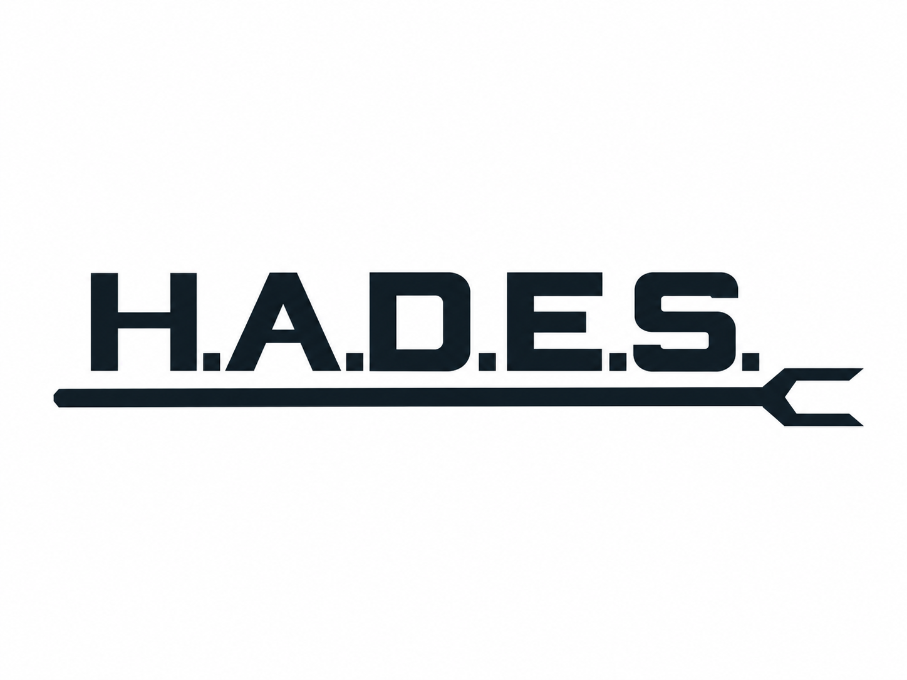

# H.A.D.E.S.

**Human Augmented Data Exploration System**



[](https://github.com/toddwbucy/HADES/actions/workflows/ci.yml)

HADES is a local knowledge workspace for reading sources, building persistent
knowledge graphs, and working with an agent over the same evidence. The human
explores and reviews in a browser. The agent retrieves context and proposes work
through MCP. Rust services and ArangoDB hold the objects, relationships, source
references, and review history behind both interfaces.

The human decides what matters. In guided reading, no interpretive note or
substantive relationship becomes accepted knowledge without human acceptance.
Archiving a source and extracting its structure are separate from accepting an
interpretation of it. IS and IS NOT boundaries state what a node represents and
excludes in its source context; an unstated boundary stays unresolved.

**Status:** active development. This README describes the current source tree.
Guided reading and the recent workspace changes are under
[Unreleased](CHANGELOG.md#unreleased), not a claim about an installed release.
The browser, CLI, MCP, extraction, and embedding components must be configured
for the workflows you use.

## What you can do

| Workflow | Current capability |
| --- | --- |
| Explore a knowledge graph | Choose databases and graphs, browse outlines and glossary terms, inspect nodes and edges, search indexed content, and copy exact references for an agent. |
| Read a source with an agent | Upload a supported document, bound the reading, highlight passages, share focus, review proposals, accept notes and connections, and arrange an outline. |
| Compare and correct extraction | View the converted text beside the original PDF, correct transcription errors, inspect revision history, and reveal the wording used by an earlier note. |
| Import a graphable document | Mechanically map declared headings, glossary terms, keywords, illustrations, and references from Markdown, preserving source versions and repeat-import identities. |
| Create and extend graphs through MCP | Provision an authorized database, create an authored graph, and add nodes or edges through scoped tools. Guided-reading endpoints deliberately restrict agents to proposals. |
| Index documents and code | Extract, chunk, embed, and retrieve source content. Code analysis records symbols and relationships with analyzer provenance. |

The graph explorer offers Read, Split, and Graph views with Auto, Wide, and
Compact layouts. The guided-reading desk has its own converted/original PDF
controls and side-by-side layout. Agent conversations remain in the agent's
terminal or client; HADES does not host a Codex or Claude Code chat session.

## Requirements

- **Linux and ArangoDB** for the local database and Unix-socket services.
  Configure a database account and the socket paths it can access.
- **Rust via rustup and `protoc`** to build. The compiler, rustfmt, and Clippy
  versions are pinned in [rust-toolchain.toml](rust-toolchain.toml).
- **Python services and model assets** for extraction or embedding. Docling
  supplies document conversion. The reference embedder uses Jina embeddings v4
  through the [embedding API contract](docs/persephone-embedding-api.md).
- **A modern browser** for the workspace, with WebGL for the graph view.

Graph reads, authored graph writes, and mechanical Markdown import do not need
an embedder. Guided-reading uploads need the extractor. Semantic search embeds
its query, so it needs a working embedder as well as indexed content.

GPU choice, context length, batch size, model paths, and service addresses are
local deployment settings. A model's maximum context is not a guarantee that it
fits on a particular GPU. Measure on the target machine, including single-card
installations, before increasing document limits.

## Build and configure

From a checkout, install the two Rust binaries into Cargo's binary directory:

```bash
cargo install --locked --path crates/hades-cli
cargo install --locked --path crates/hades-frontend
hades --help
hades-viewer --help
```

Ensure Cargo's binary directory is on `PATH`. For development without installing,
use `cargo build --locked --workspace`; binaries are in Cargo's debug target
directory. No JavaScript build step is required for the bundled browser assets.

Copy the configuration to a local file and review its database sockets, service
endpoints, and resource settings before use:

```bash
install -d -m 700 "$HOME/.config/hades"
cp -n config/hades.yaml "$HOME/.config/hades/hades.yaml"
export HADES_CONFIG="$HOME/.config/hades/hades.yaml"
export ARANGO_USERNAME=hades
read -rsp 'ArangoDB password: ' ARANGO_PASSWORD
export ARANGO_PASSWORD
```

Keep credentials out of YAML and Git. Set the same configuration and credentials
in each terminal or service that launches HADES. Examples below use `research`
as an example database, not a built-in default. Always select the database
explicitly with `--db` (alias for `--database`). CLI output defaults to JSON on
stdout, with logs and progress on stderr.

For ArangoDB account setup and systemd installation, use the
[system installation guide](docs/installation.md). For Python environments,
bindings, and service entry points, use [Python services](services/README.md).
Installing Python packages does not download every model or start services.

## Start with a database

If you already have an authorized research database, use its name and inspect it
before changing anything. To create a new one with credentials authorized to do so:

```bash
hades --db _system db create-database research
hades --db research db schema init --seed empty
hades --db research orient
hades --db research db stats
```

Schema initialization above is for a new database. Do not force a schema reset on
an existing corpus. Choose one of the workflows below to populate it.

### Explore existing knowledge

```bash
hades-viewer serve --db research --hades-bin hades --bind 127.0.0.1:8088
```

Open **http://127.0.0.1:8088/** and choose a graph. Repeat `--db` to enable more
databases in the picker. Omitting `--db` exposes all databases accessible to the
configured account. Use an explicit list when you want a narrower workspace.

The context tray copies bounded node/edge references and excerpts for an agent.
A shared link can reopen a selected object. The graph explorer is read-only and
uses **Reload** for changes made elsewhere. See
[Knowledge workspace](docs/frontend-workspace.md) for controls and limits.

### Read and review a document

The `/reading` desk uses a daemon dedicated to one reading database. Follow the
[guided-reading setup](docs/guided-reading.md#start-a-reading-workspace) to start
that daemon, the extractor, and the viewer with matching `--reading-db` and
`--reading-socket` settings. Enable its restricted MCP endpoint if an agent will
participate.

1. **Add a document.** The upload picker reflects the extractor's advertised
   formats, including PDF and DOCX. Optional converter dependencies and source
   limits still apply. The original is archived unchanged.
2. **Bound.** State what the source IS and IS NOT. Choose **Save boundaries and
   start reading** to enter Read and enable highlighting.
3. **Read.** Select text in the saved conversion and classify it as New node, IS,
   Explicit IS NOT, or Question. For PDFs, compare the original beside it.
4. **Review and connect.** Share exact focus with the agent, inspect proposed
   notes and relationships, edit them, and accept or reject the reviewed revision.
5. **Outline and export.** Order accepted notes and export an outline or the JSON
   authorship record, including model origin, human edits, and decisions.

Passage corrections create new session revisions. They do not alter the original
file or silently move earlier evidence anchors. Pins, focus, and proposals persist
separately from accepted knowledge. Scoped polling updates the reading desk;
`reading_context` lets an agent retrieve exact references, and `reading_propose`
lets it submit proposals and pins. Neither polling nor copying a reference starts
an agent turn.

This slice accepts originals up to **8 MiB** and converted surfaces up to **4 MiB**.
It does not automatically embed accepted notes or corrections. See
[Guided document reading](docs/guided-reading.md) for recovery, attribution,
stage requirements, and session limits.

### Import an already graphable document

```bash
hades --db research graphable import paper.md --graph theory --dry-run
hades --db research graphable import paper.md --graph theory --create-graph
```

The importer maps declared structure without rewriting the argument or inventing
interpretive relationships. Identical repeats verify stored rows and add only
missing ones; conflicts stop rather than overwrite reviewed content. New source
versions retain earlier versions. This path accepts graphable Markdown, not a
raw PDF or DOCX, and is currently a CLI operation.

See [Graphable document ingestion](docs/graphable-document-ingestion.md) for the
mapping, source archives, unresolved references, and retry behavior.

### Ingest and search source content

With the extractor and embedder configured, ingest a document into the new
schema's document profile:

```bash
hades --db research ingest /path/to/paper.pdf
hades --db research db query "context and memory" -c default -n 5
```

For a code repository, use the repository root consistently:

```bash
hades --db research codebase ingest /path/to/project
hades --db research db query "configuration loading" -c codebase -n 5
hades --db research codebase validate
```

Rust, Go, Python, and C/C++/CUDA have dedicated analysis paths or integrations,
with Tree-sitter fallbacks and explicit fidelity reporting. Some paths require
rust-analyzer, gopls, or libclang. See the
[code graph ontology](docs/codebase-graph-ontology.md) and
[code identity rules](docs/code-file-identities.md) before incremental updates.

**Mapped, embedded, and searchable are different states.** Authored `kg_*` writes,
mechanical imports, and accepted reading notes are traversable graph content;
they are not automatically embedded for `db_query`. Semantic retrieval searches
the selected collection profile, usually `default` for documents or `codebase`
for code. Inspect `orient` and `db stats` before interpreting an empty result.
The `--rerank` option is not implemented and exits with an error.

## Connect an agent through MCP

`hades daemon --mcp-bind` provides streamable HTTP at `/mcp`, authenticated with a
bearer-token file. The endpoint offers database orientation, semantic search,
object lookup, traversal, ingestion job status, and task operations. Optional
provisioning adds `create_database`, schema initialization, ingestion, and
`kg_create`, `kg_add_node`, and `kg_add_edge`.

Provisioning is opt-in and constrained by database prefixes, allowed source roots,
and ArangoDB permissions. Host-side paths passed to ingestion refer to the HADES
server's filesystem. A general provisioning endpoint can write directly; a
`--mcp-guided-reading` endpoint denies those direct writes and allows proposals
for human acceptance instead.

See [MCP deployment](docs/mcp-deployment.md) for endpoint setup and scope rules,
and [Daemon protocol](docs/daemon-protocol.md) for the wire contracts. Some
operational measurements in those documents describe a particular workstation;
keep your own addresses, tokens, models, and GPU configuration local.

The viewer and MCP server bind to loopback or private LAN addresses. Use `--password-file` for LAN viewer
authentication; guided reading requires file-based passwords. MCP uses a separate token. These listeners serve
plain HTTP, not TLS. Use the documented tunnel or proxy setup when needed.
A merged change does not update a running service: install the intended binaries,
restart the relevant services, and verify their advertised operations.

## Architecture and repository layout

| Component | Responsibility |
| --- | --- |
| `crates/hades-frontend` | Browser graph explorer and reading desk. Graph reads use CLI JSON; reading operations use the daemon's Unix socket. |
| `crates/hades-cli` | `hades` commands, daemon entry point, and MCP transport. |
| `crates/hades-core` | Shared operations, graphable import, guided-reading state, configuration, ArangoDB access, analysis, and ingestion pipelines. |
| `crates/hades-proto`, `proto/` | gRPC contracts and generated Rust bindings. |
| `crates/hades-prefetch` | Graph-aware batch preparation for training. |
| `services/` | Python Docling extraction, embedding, training, and adapters. |
| `config/`, `seeds/` | Configuration templates and runtime schema seeds. |
| `docs/`, `Bastion/` | User/developer documentation, architecture, research methodology, and audit evidence. |
| `scripts/`, `deploy/`, `services/systemd/` | Validation, packaging, and deployment templates. |

ArangoDB stores persistent graph data and reading records. Extraction and
embedding are separate services. Runtime schema data describes collection
profiles and graph structure. Participant labels record attribution; they are
not a substitute for credentials or authorization.

## Development and validation

```bash
cargo build --locked --workspace
cargo fmt --all -- --check
cargo clippy --workspace --all-targets -- -D warnings
cargo test --workspace --lib --bins
cargo test -p hades-proto --test proto_types
cargo test -p hades-core --test pipeline
cargo test -p hades-core --test config_integration
```

Database-backed tests need explicit isolated fixtures. After fetching Cargo
dependencies, the runner can provision a private server:

```bash
cargo fetch --locked
python3 scripts/test_isolated_database.py --docker
# Or use a local test-server binary:
python3 scripts/test_isolated_database.py --arangod /path/to/arangod
```

See [Test environments](docs/specs/workstation-specific-tests.md) for Python CPU
contracts, analyzers, resource limits, and optional hardware checks. The
[guided-reading validation](docs/guided-reading.md#focused-validation) runs real PDF/DOCX
extraction, browser actions, MCP proposals, human acceptance, recovery, and export
against private services. Automated write tests must not use research corpora.

Issues and pull requests are welcome. Explain the behavior changed and the
validation performed, and add a categorized entry under `[Unreleased]` in
[CHANGELOG.md](CHANGELOG.md).

## Research and authorship

HADES grew from research into context engineering, agent memory, and
ontology-grounded retrieval. Todd W. Bucy directs the research and architecture
and owns the resulting codebase, with implementation assistance from AI coding
agents. The current workspace makes that division explicit: the agent can offer
analysis, while the human determines what enters accepted knowledge.

For the underlying method, see [Graph methodology](Bastion/graph-methodology.md),
[The Bastion](Bastion/foundation/the-bastion.md), and
[Bastion of Context](Bastion/foundation/bastion-of-context.md).

## License

[Apache License 2.0](LICENSE).
