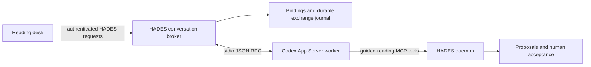

# Codex conversations alongside guided reading

Investigation for [#214](https://github.com/toddwbucy/HADES/issues/214).
Verified on 2026-10-18 with **codex-cli 0.163.0** on Linux, using the configured
`gpt-6-astra` model. The original investigation below is preserved as protocol
evidence. The Codex broker and reading-desk integration now implement its follow-ups;
see [setup and recovery](../codex-reading.md). Claude-specific verification is deferred.

## Decision

Support **New conversation**, **Resume conversation**, and **Reference conversation**.
Conversations may originate outside HADES. A reference copies selected history into
a new exchange; it does not resume or take control of the source conversation.

Codex enforces an exclusive writer for both tested history formats. Use
`thread/resume` as the atomic acquisition attempt and treat an active-writer error
as **In use elsewhere**. Never take over, kill an external client, edit its lock
files, or silently substitute a new conversation. Offer read-only referencing or
an explicit handoff after the user exits the owning client.

The restriction applies to an idle attached client as well as a generating one.
`notLoaded` and an empty `thread/loaded/list` describe the queried App Server, not
all processes. They cannot establish that a conversation is available.

## Evidence

All inference used synthetic text in an isolated Codex home. No existing user
conversation was resumed, and no HADES database was opened. The reproducible probe
is [scripts/probe_codex_reading.py](../../scripts/probe_codex_reading.py).

| Experiment | Observed result | Consequence |
| --- | --- | --- |
| Create a conversation using `codex exec`, then list it through App Server | The default list omitted it; explicit source filters included it | Include `cli`, `vscode`, `exec`, and `appServer`; inspect actual source metadata |
| Read its turn history before resume | Full user/assistant items were returned; no thread was loaded | History selection can be read-only |
| Resume a persisted thread in one App Server, then in another | Second resume failed with code `-32600`, message containing `already has an active writer` | Use the runtime's writer exclusion, not a status precheck |
| Read status from the second process while the first owned the thread | `notLoaded` | Status is not a cross-process ownership signal |
| Resume while `codex exec resume` was running | Same active-writer rejection | CLI ownership is respected; separately exercised during exploratory testing |
| Exit the owner, then resume | Succeeded; the model recalled the phrase from the CLI-created conversation | Explicit handoff preserves history |
| Unsubscribe the owning connection, then immediately try another writer | Still refused; closing the owner released it | Unsubscribe is not an immediate handoff |
| Kill a disposable owning worker, then resume in another | Succeeded | The tested runtime released ownership after process death |
| Send the same `clientUserMessageId` twice | Two different turns; both persisted the same user-message `clientId` | The field correlates messages; it is not an idempotency guarantee |
| Freeze a selected passage, then change selection | Response used the frozen passage | Each exchange needs its own immutable context |
| Drop the local acknowledgement, close the worker, reopen the binding | History matched the client ID to the completed turn; no resend was needed | Persist a submission journal before dispatch |
| Reopen the document fixture and worker, then continue | Position and provider thread survived; the model recalled the earlier passage | Conversation state remains in Codex; HADES stores its binding and exchange provenance |
| Deny a command approval | Agent stopped without executing the requested command | Approval requests can be surfaced and answered independently of graph acceptance |
| Interrupt while waiting for approval | Turn became `interrupted`; approval resolution could arrive afterward; a subsequent turn succeeded | Clear pending approval UI on terminal turn status and tolerate late resolution |
| Repeat ownership/history checks with `historyMode: legacy` | Writer exclusion and `thread/turns/list` worked; `thread/items/list` returned `-32601` unsupported | Use turn pagination as the compatibility path |
| Resume a nonexistent thread ID | Explicit no-rollout error | Missing history must be handled without silently starting another conversation |

The final reproducible run passed. Its sanitized
[evidence summary](codex-reading-evidence.json) records the checks; raw synthetic
transcripts and authentication are not included in the repository. The initial
run exposed the late approval-resolution notification described above; the probe
now waits for that notification independently of terminal turn status.

The active-CLI experiment used a synthetic thread and the harmless `sleep 5`
command to keep the CLI turn open long enough for a second client to attempt
resume. The main reproducible probe uses independent App Server processes for
the ownership assertion; it does not require controlling a terminal UI.

The protocol details were checked against the installed binary's generated schema:

```bash
codex --version
codex app-server generate-json-schema --out /tmp/codex-reading-schema
```

The [official App Server reference](https://learn.chatgpt.com/docs/app-server)
documents the stdio control interface, thread and turn operations, event streams,
approval requests, and authentication. It supports managed ChatGPT sign-in and
API-key authentication. This experiment used a private temporary copy of existing
Codex authentication; it does not establish eligibility or billing for other accounts.
Runtime observations above take precedence over assuming identical behavior from
documentation or a different binary version.

## Architecture



Implement the broker behind HADES's existing backend boundary. Keep agent process
management and credentials out of browser JavaScript. The viewer forwards domain
requests and receives streamed events; it does not embed another agent runtime.
The investigation's Python probe is a disposable driver, not a commitment to an
additional production Python service.

Use a dedicated worker per actively controlled conversation initially. This gives
an explicit release boundary without terminating other conversations. A browser
disconnect should detach the view, not immediately kill an in-flight turn. An
explicit **Release to another client** action should interrupt or finish active
work, reconcile its terminal state, then close that worker. Verify lock release
before reporting handoff complete. Do not use archive/delete as release operations.

The broker must also prevent two HADES bindings or browser tabs from independently
dispatching into the same worker. Codex's cross-process writer exclusion does not
replace HADES's own request serialization and approval ownership.

A runtime profile identifies the Codex executable/version, local history home,
working directory, authentication mode, permission policy, and allowed MCP
configuration. Validate the effective profile on resume. An imported conversation
must not inherit unrestricted graph-write tools merely because its previous client
used them. Retain the guided-reading MCP restrictions described in
[guided-reading.md](../guided-reading.md). Tool approval never accepts a knowledge
graph proposal on the reader's behalf. The initial investigation did not reconnect
MCP or exercise proposal acceptance.
The subsequent [implementation validation](codex-reading-integration-evidence.json)
now covers both through the real browser and a disposable database.

## Persistent contracts

Propose two new records, with database-scoped uniqueness and explicit format versions:

| Record | Minimum fields |
| --- | --- |
| Conversation binding | `id`, `reading_session_id`, `source_hash`, `provider: codex`, `runtime_profile_id`, `thread_id`, reader position, connection state |
| Exchange | `request_id`, binding ID, exact user message, frozen context JSON and digest, provider turn ID when known, dispatch/terminal state, timestamps, error summary |

A reading session may have several conversation bindings, and one conversation
may be referenced from several documents. Serialize control by runtime profile
and provider thread ID, not by document. Reader position belongs to the reading
view; changing it does not rewrite earlier exchanges.

Reuse existing source hashes, passage anchors/revisions, session revisions, and
selected graph identities. The context snapshot contains:

- Document identity and source hash; reading-session and passage revisions.
- The exact selected passage and its locator.
- Explicitly selected graph material with its recorded revision or content digest.
- Explicit conversation references: provider thread, turn/item IDs, copied text,
  capture time, and digest. Include only selected material, not every tool result.
- Disclosure of omitted context and the exact bounded payload sent to Codex.

Keep the existing 12,000-byte context bound as the initial budget. Show what is
included; do not silently truncate selected text. Snapshot **before Send**, persist
it, then dispatch that exact representation. If the reader changes source or
corrects a passage, keep prior exchanges tied to their original revisions and
label them accordingly. New exchanges use the newly selected revision.

The live MCP `reading_context` operation can observe later focus changes. A frozen
chat payload does not freeze later MCP reads. Follow-up work must add a way to
retrieve the exchange's context by ID, or clearly distinguish subsequently fetched
live context and its revision. Proposals must retain their actual passage basis.

Codex owns resumable conversation history. HADES stores the exchange provenance
and a UI projection, not a replacement for Codex's internal conversation store.
Persist terminal text/tool summaries needed to reopen the view; raw streaming
deltas need not become graph events.

## Dispatch and recovery

Use a durable outbox with these states:

```text
prepared -> dispatching -> acknowledged -> completed | interrupted | failed
                    \-> outcome unknown -> reconcile or explicit recovery
```

1. Validate the binding and context, then persist a unique request ID and exact payload.
2. Atomically claim the prepared request and commit **before** writing `turn/start`.
3. Send the request ID as `clientUserMessageId`; save the returned provider turn ID.
4. Route events by worker connection, thread ID, turn ID, and item/request ID.
5. After reconnect, page history and correlate `userMessage.clientId` to the request.
   One matching turn supplies the receipt; multiple matches require explicit
   recovery. An absent match is not permission to resend automatically.

The uncertainty includes a crash between the durable claim and socket write.
Keeping an unresolved request is preferable to executing it twice. History reads
must finish pagination before deciding a receipt is absent; expose an incomplete
search instead of making that inference after a capped first page.

On missing thread/history, retain the document and journal and offer explicit
relink/reference/new actions. Never silently replace the conversation. A newly
started empty thread was not readable from another process before its first turn
in exploratory testing; distinguish that draft state from a confirmed persisted
conversation.

Pending approvals are scoped to the connection that issued their RPC IDs. Never
replay an approval response onto a replacement connection. Clear them when the
turn becomes terminal, even if `serverRequest/resolved` arrives later. The probe
denies a harmless command; approving commands, file changes, permission grants,
user-input requests, and MCP elicitation still need dedicated UI coverage.

## Reproduce

The live probe makes authenticated inference requests and consumes the supplied
account's applicable usage. It requires an existing Codex authentication file,
the tested CLI or a version being evaluated, Python 3, and network access.

```bash
python3 -m unittest discover -s scripts/tests -p 'test_codex_reading_probe.py' -v
python3 scripts/probe_codex_reading.py \
  --run-live \
  --auth-file "$HOME/.codex/auth.json" \
  --model gpt-6-astra \
  --output /tmp/hades-codex-reading-probe
```

The output directory must not exist. It is private and contains the synthetic
document, exchange journal, protocol events, runtime history, and `report.json`.
The script copies credentials into a separate runtime home and removes that copy
on normal completion or caught failure. If forcibly killed, remove the temporary
`runtime/auth.json` before sharing or retaining the directory. Do not commit raw
runtime output. No production configuration or user transcript is copied.

Six service-free tests cover nested snapshot immutability, changed-payload rejection,
durable ambiguous-send protection, exclusive journal claims, receipt ambiguity,
and the UTF-8 byte limit. The live probe covers the actual runtime rather than
mocking its writer lock or message-ID behavior.

## Implementation status and remaining limits

The Codex follow-ups are implemented in `hades-core::reading::chat`, the reading
HTTP adapter, and `reading-chat.js`: supervised workers, runtime profiles,
conversation discovery/reference/resume, durable bindings/exchanges, frozen
context, history reconciliation, approval/input handling, and explicit release.
`reading_exchange_context` exposes each immutable snapshot through MCP. The
[operator guide](../codex-reading.md) documents configuration and recovery.

The browser contract uses a disposable database and verifies MCP proposals remain
pending until human acceptance. Controlled tests cover duplicate submissions,
source corrections, reference provenance, cancellation, lost acknowledgements,
pagination, stale browser responses, and daemon-crash ownership recovery. Real
Codex inference verifies the same browser/MCP integration, restricted tool inventory,
release, and resume. See [sanitized integration evidence](codex-reading-integration-evidence.json).

The production implementation commits directly to `dispatching` before writing to
Codex; a separate `prepared` queue is unnecessary for its single dispatch owner.
Browser updates poll a bounded live projection. Only the verified runtime version
is enabled, including for history browsing. Its supported approval policy is
`on-request`; the runtime rejects `untrusted`. **Allow once** authorizes only the
pending allowlisted call. An explicit **Always allow reads in this conversation**
choice persists `allow_reads` on the HADES binding and is revocable while connected
or disconnected. The broker answers verified read-tool prompts on that worker;
it does not persist grants in Codex or broaden the runtime's tool inventory.
It matches the current thread/turn, server, empty approval schema, and a unique
in-progress call with matching arguments. Ambiguous calls and proposals never
qualify. Permission changes serialize with binding lifecycle operations and
live approval decisions; grants become active only after successful persistence.

Claude's ownership, history, resume, approval, cancellation, and authentication
constraints still require independent verification. This implementation does not
claim universal access to ChatGPT web/cloud conversations, cross-machine history
transfer, or compatibility with untested Codex versions.
